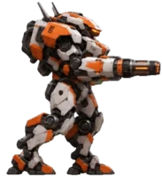

# SpriteSheetGen

[English](README.md) · [简体中文](README.zh-CN.md) · **日本語** · [한국어](README.ko.md)

[](https://www.npmjs.com/package/@spritesheetgen/cli)

2D ゲーム用スプライトシートを作る AI ツールです。**MCP サーバー**と **CLI** で使えます。キャラクターを説明して動かす（歩く・走る・待機・攻撃・ジャンプ）と、エンジンでそのまま使えるファイルがプロジェクトのフォルダに入ります：スプライトシート PNG、TexturePacker JSON アトラス、Godot 4 の `SpriteFrames` リソース、単体フレーム、GIF プレビュー。

**製品：[spritesheetgen.com](https://spritesheetgen.com/ja/)** · **ドキュメント：[terror668.github.io/spritesheetgen/ja](https://terror668.github.io/spritesheetgen/ja/)**

ブラウザで使える無料ツール：[動画からスプライトシート](https://spritesheetgen.com/ja/video-to-sprite-sheet/)、[GIF からスプライトシート](https://spritesheetgen.com/ja/gif-to-sprite-sheet/)、[スプライトシート作成](https://spritesheetgen.com/ja/sprite-sheet-maker/)、[スプライトシート分割](https://spritesheetgen.com/ja/sprite-sheet-cutter/)、[スプライトシートから GIF](https://spritesheetgen.com/ja/sprite-sheet-to-gif/)

<p align="center">
  
  
  
  
</p>

## AI エージェントでセットアップ

Claude Code、Codex など MCP 対応のエージェントにこう送ります：

```text
SpriteSheetGen をセットアップして：https://spritesheetgen.com/agents/install.txt の手順に従って
```

エージェントが MCP サーバーとスキルをインストールします。次に <https://spritesheetgen.com/ja/account/> で API キーを作成し、**ご自身のターミナル**で保存します（入力は表示されません。チャットには貼らないでください）：

```sh
npx -y @spritesheetgen/cli login
```

## MCP サーバーを手動で追加

```sh
# Claude Code
claude mcp add spritesheetgen -s user -- npx -y @spritesheetgen/cli mcp

# Codex
codex mcp add spritesheetgen -- npx -y @spritesheetgen/cli mcp
```

Claude Desktop、Cursor、Windsurf など `mcpServers` 設定ファイルを読むクライアント（[examples/mcp.json](examples/mcp.json)）：

```json
{
  "mcpServers": {
    "spritesheetgen": {
      "command": "npx",
      "args": ["-y", "@spritesheetgen/cli", "mcp"]
    }
  }
}
```

Node.js 20 以上が必要です。サーバーは stdio で動き、`login` で保存したキー（または `SPRITESHEETGEN_API_KEY`）を読むので、あとからログインしても再起動は不要です。

## ツール

| ツール | クレジット | 内容 |
| --- | --- | --- |
| `estimate_sprite` | 無料 | キャラクターや動作の価格、残高、キーの残り予算を確認 |
| `improve_prompt` | 無料（1 日の回数制限あり） | ざっくりしたアイデアを生成しやすいキャラクター説明に整える |
| `create_character` | 有料 | 説明からキャラクター画像を 1 枚生成 |
| `upload_character` | 無料 | 手持ちの PNG・JPEG・WebP のキャラクターを使う |
| `animate_character` | 有料 | アニメーションを 1 つ生成：`walk`、`run`、`idle`、`attack`、`jump` |
| `get_generation` | 無料 | 生成の状態と結果を確認（完了まで待つことも可能） |
| `list_characters` | 無料 | 生成またはアップロードしたキャラクターの一覧 |
| `list_actions` | 無料 | キャラクターが持っているアニメーションの一覧（二重払いを防ぐ） |
| `export_sprite_sheet` | 無料 | 完成したアニメーション（または手元の GIF）をローカルのフォルダに書き出す |

エージェントは必ず先に見積もりを出し、あなたが了承してから消費します。有料の呼び出しには `max_credits` の上限と `client_key` が付くので、再試行しても二重に請求されません。

## API キーと利用上限

キーは[アカウントページ](https://spritesheetgen.com/ja/account/)で作成します。キーごとに権限と 1 日・合計のクレジット上限があり、許可するまで新しいキーは消費できません。キーは `~/.config/spritesheetgen/credentials`（Windows は `%APPDATA%`）に保存され、本人だけが読めます。`logout` で削除します。

新規アカウントには 25 クレジット。最新の価格は[料金ページ](https://spritesheetgen.com/ja/pricing/)にあり、見積もりツールは常に現在の価格を返します。

## CLI

MCP なしでも同じ機能が使えます：

```sh
npx -y @spritesheetgen/cli --help

spritesheetgen estimate --description "a small beetle knight" --json
spritesheetgen character --description "a small beetle knight" --client-key my-unique-key-0001 --max-credits 5 --json
spritesheetgen animate --reference generation:CHARACTER_ID --action walk --client-key my-unique-key-0002 --max-credits 10 --json
spritesheetgen export --id ANIMATION_ID --out ./assets/beetle-walk --name walk --individual-frames --preview --json
```

手持ちの GIF の書き出しはキー不要・無料です：

```sh
npx -y @spritesheetgen/cli export --file ./walk.gif --out ./assets/walk --name hero_walk --preview
```

## 書き出されるファイル

サンプルは [samples/little-knight-walk](samples/little-knight-walk)：グリーンバックの騎士の歩きを CLI で書き出したもの（背景除去、エッジ処理、フレーム位置合わせ）。

| ファイル | 使い道 |
| --- | --- |
| `sheet.png` | どのエンジンでも：フレームを 1 行（またはグリッド）に並べた透明 PNG |
| `sheet.json` | Phaser、PixiJS など TexturePacker JSON（hash）を読むエンジン（`animations` 付き） |
| `animation.tres` | Godot 4：`AnimatedSprite2D` 用の `SpriteFrames` リソース（速度とループ設定済み） |
| `preview.gif` | すぐに確認するためのプレビュー |
| `export.json` | 使った設定（同じ書き出しを繰り返すため） |
| `frames/*.png`、`frames.zip` | Unity、GameMaker など単体画像を使うツール（`--individual-frames`） |

Phaser 3：

```js
this.load.atlas("knight", "sheet.png", "sheet.json");
this.anims.create({ key: "walk", frames: this.anims.generateFrameNames("knight", { prefix: "knight_walk_", end: 11, zeroPad: 2 }), frameRate: 14, repeat: -1 });
```

Godot 4：`sheet.png` と `animation.tres` を同じフォルダに置き、`animation.tres` を `AnimatedSprite2D` の **Sprite Frames** にドラッグします。

## このリポジトリについて

npm パッケージ `@spritesheetgen/cli` のドキュメント、設定例、書き出しサンプルを置いています。質問や不具合は [issues](../../issues) か support@spritesheetgen.com へどうぞ。

このリポジトリの内容は [MIT ライセンス](LICENSE)で公開しています。
